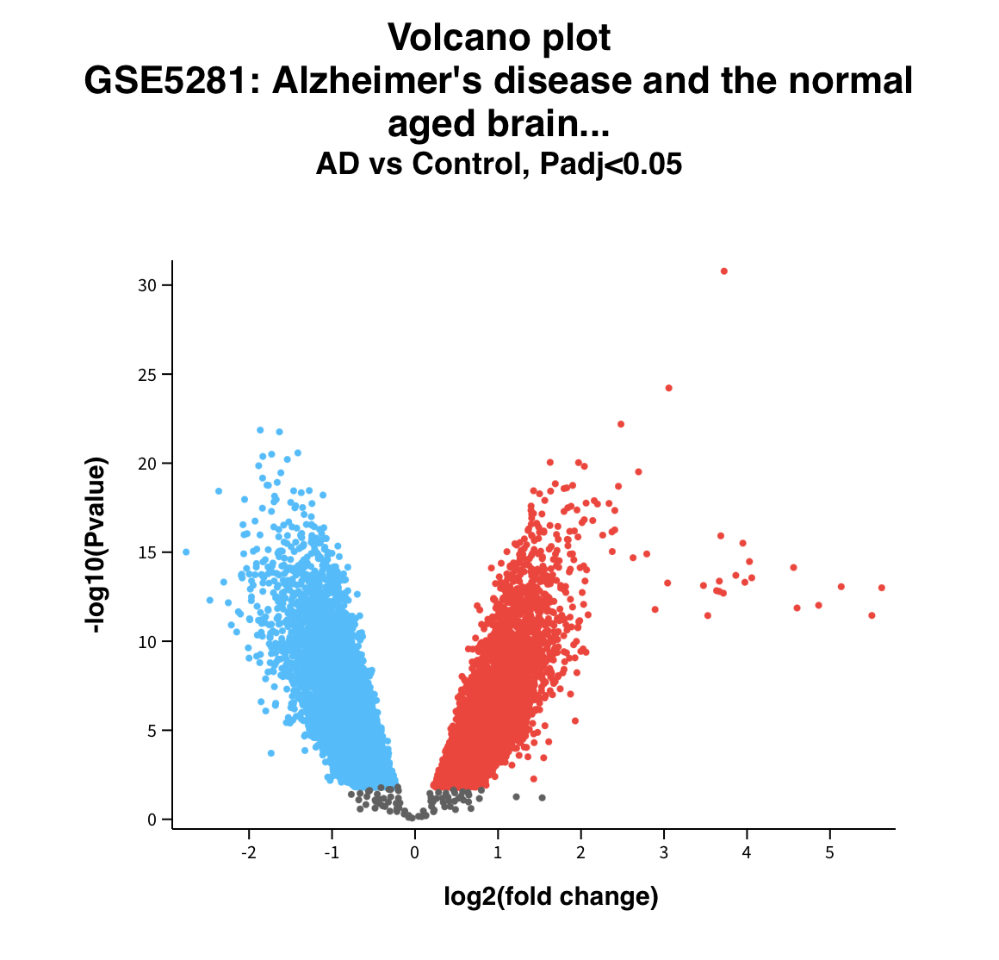

# Differential Gene Expression Analysis in Alzheimer’s Disease Neurons (GSE5281)

## Goal
The goal of this project was to identify genes that are significantly differentially expressed in laser-captured neurons from Alzheimer’s disease patients compared with healthy controls, and to interpret the biological meaning of the strongest changes.

## Dataset
This analysis uses the publicly available dataset **GSE5281** from the NCBI Gene Expression Omnibus:  
[https://www.ncbi.nlm.nih.gov/geo/query/acc.cgi?acc=GSE5281](https://www.ncbi.nlm.nih.gov/geo/query/acc.cgi?acc=GSE5281)

GSE5281 contains gene expression profiles from laser-captured layer III pyramidal neurons collected across multiple brain regions. The dataset includes approximately 87 Alzheimer’s disease samples and 74 non-demented control samples, generated on the Affymetrix Human Genome U133 Plus 2.0 Array. This dataset was chosen because it focuses specifically on individual neurons rather than bulk tissue, making it well-suited for examining cell-level expression changes in Alzheimer’s disease.

## Methods
Differential expression analysis was performed using the GEO2R tool (NCBI).  

Steps taken:
1. Opened the GSE5281 dataset in GEO2R.
2. Defined two groups: “AD” (Alzheimer’s disease samples) and “Control” (non-demented samples).
3. Ran the analysis using default limma settings.
4. Downloaded the full results table.
5. Sorted genes by –log10 p-value to identify the strongest statistical changes.
6. Examined both statistical significance and log2 fold change.
7. Selected the most significant and biologically relevant genes for further interpretation.
8. Researched the function of the top genes using GeneCards and published literature.

## Gene Selection Criteria
Genes were prioritized based on two main factors:
- High statistical significance (largest –log10 p-values)
- Biological relevance to known Alzheimer’s disease processes (mitochondrial function, cytoskeleton, calcium signaling, stress responses, and tau-related pathways)

A final set of seven genes was selected for detailed interpretation.

## Results

## Key Findings

**Upregulated in Alzheimer’s neurons:**
- **NEAT1** — A long non-coding RNA involved in cellular stress responses. Multiple studies have linked NEAT1 to Alzheimer’s pathology and astrocyte reactivity.
- **ITPKB** — An enzyme involved in calcium signaling. Research has shown that ITPKB is elevated in Alzheimer’s brains and can influence amyloid production and tau phosphorylation.
- **ACACB** — Acetyl-CoA carboxylase beta, which regulates mitochondrial fatty-acid oxidation. Its upregulation suggests altered energy and lipid metabolism.

**Downregulated in Alzheimer’s neurons:**
- **ATP5B** and **ATP5C1** — Both are subunits of mitochondrial ATP synthase, the complex responsible for producing ATP. Reduced expression is consistent with the well-documented energy failure in Alzheimer’s neurons.
- **TUBB** — Beta-tubulin, a core structural component of microtubules. Downregulation supports the known disruption of the neuronal cytoskeleton in Alzheimer’s disease.
- **YWHAZ** — Encodes 14-3-3 zeta, a signaling protein that interacts with tau and is found in neurofibrillary tangles.

A summary table of these genes is available here: [top-genes.md](top-genes.md)

## Biological Interpretation
The expression pattern observed in this analysis aligns with several core features of Alzheimer’s disease. The downregulation of ATP synthase subunits (ATP5B and ATP5C1) points to impaired mitochondrial energy production. Reduced TUBB expression is consistent with cytoskeletal instability and tau-related pathology. At the same time, upregulation of NEAT1, ITPKB, and ACACB suggests that neurons are experiencing increased stress, disrupted calcium signaling, and changes in lipid metabolism. Together, these findings support the view that Alzheimer’s neurons face simultaneous metabolic, structural, and signaling challenges.

## Workflow Summary
1. Identified and selected the GSE5281 dataset.
2. Performed differential expression analysis in GEO2R.
3. Ranked and filtered results by statistical significance and fold change.
4. Selected top genes based on both statistics and biological relevance.
5. Researched gene functions and Alzheimer’s disease associations.
6. Created visualizations and a summary table.
7. Documented the full analysis and interpretation in this repository.

## Limitations
This is an exploratory analysis that relies on GEO2R default settings. While the results are consistent with known Alzheimer’s biology, they should be viewed as hypothesis-generating. No custom batch correction, pathway enrichment, or independent validation was performed in this project.

## Conclusion
This project demonstrates the ability to work with public transcriptomic data, carry out differential expression analysis, critically select relevant genes, and connect statistical results to biological context in Alzheimer’s disease.

## Files Included
- `Volcano-plot.png` — Volcano plot generated by GEO2R
- `top-genes.md` — Table of the top differentially expressed genes highlighted in this analysis
